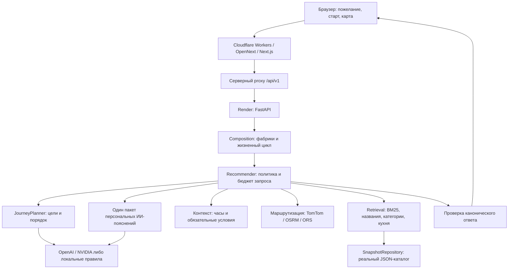

# Архитектура Astana Compass

Документ описывает реализованную систему. Необязательный профиль PostgreSQL/pgvector и дальнейшие направления развития отделены от работающего приложения.

## Устройство системы

Astana Compass превращает описание прогулки в последовательность реальных мест и связанный пеший маршрут. Модель помогает понять пожелание и объяснить выбор; идентификаторы мест, подтверждённые свойства и геометрию пути определяют каталог и профильные провайдеры.

Приложение разделено на два развёртываемых компонента: интерфейс Next.js на Cloudflare Workers через OpenNext и Python API в Docker на Render. Внутри API пакеты работают в одном процессе через типизированные порты. Такое разделение сохраняет независимость модулей без сетевых вызовов между каждым этапом поиска.

Картографическая подложка OpenFreeMap и MapLibre отображается отдельно от каталога рекомендаций. Наличие здания на карте не означает, что о нём есть полная карточка, проверенные удобства или часы работы.

## Границы модулей и точки входа

| Область | Реализация | Ответственность |
|---|---|---|
| Интерфейс | [apps/web](apps/web/README.md), [CompassApp](apps/web/src/components/compass-app.tsx) | Карта, мобильная шторка, пожелание, фильтры, карточки, компания, избранное, локальные состояния |
| Серверный proxy | [route.ts](apps/web/src/app/api/v1/[...path]/route.ts), [social proxy](apps/web/src/app/api/v1/social/[operation]/route.ts) | Разрешённые пути и методы, ограничение тела и времени, безопасные ответы, отдельный поток гостевой cookie |
| HTTP API | [app.py](services/api/src/astana_api/app.py), [composition.py](services/api/src/astana_api/composition.py) | Валидация входа, request ID, ошибки, создание и закрытие зависимостей |
| Контракты | [contracts.schema.json](contracts.schema.json), [порты](packages/contracts/src/astana_contracts/ports.py), [API client](packages/api_client) | Единые структуры Python/TypeScript и проверка границ |
| Каталог и импорт | [city_data](packages/city_data/README.md) | Снимок POI, атрибуция, источники и состояния фактов, воспроизводимый импорт |
| Поиск | [retrieval](packages/retrieval/README.md) | BM25, RU/KK/EN-лексикон, исходные названия, категории и кухня, ограниченный пул кандидатов |
| План и отбор | [recommender/service.py](packages/recommender/src/astana_recommender/service.py) | Выполнение целей, проверка условий, бюджет, отбор, предупреждения, сборка ответа |
| ИИ | [ai_providers](packages/ai_providers/README.md), [journeys.py](packages/ai_providers/src/astana_ai_providers/journeys.py), [narratives.py](packages/ai_providers/src/astana_ai_providers/narratives.py) | Структурированный разбор сценария и персональные пояснения по найденным местам |
| Контекст и путь | [city_context](packages/city_context/README.md) | Расписания, пешие маршруты, проверка геометрии, ограничения и деградация провайдеров |
| Социальные функции | [social.py](services/api/src/astana_api/social.py) | Гостевые профили, друзья, компании, чат, общий план и добровольная передача местоположения |
| Дополнительные сведения | [map_features.py](services/api/src/astana_api/map_features.py), [twogis_places.py](services/api/src/astana_api/twogis_places.py), [place_photos.py](services/api/src/astana_api/place_photos.py) | Сведения по выбранной карте, отдельный поиск 2GIS, фото и атрибуция |

Фабрики `astana_city_data:create_repository`, `astana_retrieval:create_retriever` и `astana_city_context:create_context` подключаются в composition. Порты `PlaceRepository`, `Retriever`, `ContextProvider`, `JourneyPlanner` и `RecommendationService` позволяют подменять внешние зависимости в изолированных проверках. Незавершённая инициализация закрывает уже созданные HTTP-клиенты; нормальное завершение закрывает весь стек ресурсов.

## Как обрабатывается пожелание

1. **Ввод.** Пользователь задаёт старт на карте, через геолокацию либо координаты и описывает прогулку своими словами. Отдельные ручные фильтры изначально выключены. Применённый запрос хранится в ответе; редактирование черновика не переписывает уже показанное объяснение.
2. **Понимание сценария.** `JourneyPlanner` выделяет цели, названия, категории, кухню, исключения и отношения порядка. Например, «зайти в торговый центр по пути в ботанический сад» означает промежуточный торговый центр перед конечным садом. Модель не выдаёт выдуманные ID заведений. Схема и локальные проверки ограничивают её ответ; при недоступности провайдера используется явно различимый разбор правилами.
3. **Поиск по реальным данным.** Каждый этап получает собственный запрос. Поиск работает по локальному снимку: BM25, многоязычная нормализация, категории и исходные имена. Полное исходное название приоритетнее вложенного короткого имени: кафе Mega не заменяет MEGA Silk Way. Известная кухня проверяется отдельно от общего типа заведения.
4. **Проверка условий.** Источники и контекст определяют известные свойства. Неизвестное обязательное свойство не считается выполненным. Независимые цели получают отдельные места; один случайный ближайший объект не подставляется вместо пропущенного желания. Неполный план и вопросы остаются видимыми.
5. **Оценка переходов.** API получает ограниченное число маршрутных оценок для выбранных кандидатов. Время посещения — оценка; часы из источника не гарантируют работу к прибытию и на весь визит. Желаемая продолжительность служит мягким ориентиром: более длинный вариант сохраняется с полным временем и явным превышением.
6. **Персональное объяснение.** После отбора один дополнительный запрос к настроенной модели пишет пояснения для максимум шести выбранных мест. В нём есть исходное пожелание, роль остановки и ограниченные публичные сведения места. Ответ заменяет служебные фразы о номере этапа и категории каталога. Проверяются принадлежность ссылок конкретному месту, формат и размер; это снижает риск выдумок, но не доказывает истинность каждой фразы. Текст остаётся советом ИИ и не записывается как подтверждённый факт.
7. **Дополнительные идеи.** Если все основные цели покрыты и осталось время обработки, отдельный локальный поиск может предложить до двух необязательных мест. Они подписаны как предложения и не добавляются в маршрут без действия пользователя.
8. **Общий маршрут.** Клиент запрашивает `/v1/itineraries` для последовательности выбранных ID. API строит полный упорядоченный путь через все остановки и, если выбрано, обратно к старту. На карте участки различаются цветом, показаны стрелки и номера. Удаление или перестановка остановки вызывает пересчёт всего пути.

Рекомендации содержат оценки дороги для отдельных кандидатов; полноценная линия путешествия берётся из ответа itinerary. Эти два расчёта не следует смешивать при подсчёте времени или демонстрации результата.

## Контракты и модель фактов

[Каноническая JSON Schema](contracts.schema.json) — источник форматов на границах. Python валидирует ответы зависимостей и конечные ответы, TypeScript-клиент и runtime-валидаторы синхронизируются с ней. [CONTRACTS.md](CONTRACTS.md) описывает порты и соглашения; [docs/api](docs/api/README.md) — HTTP-поведение.

- `Place` связывает стабильный ID, название, категории, координаты, факты и evidence.
- `PlaceFact` различает `known`, `unknown` и `conflicting`; отсутствие данных не превращается в `false`.
- Ссылки на evidence, даты и атрибуция принадлежат источникам. Дата импорта не является датой проверки удобства на месте.
- `required` и `preferred` имеют разные последствия. Модель или ранжирование не могут незаметно ослабить обязательное условие.
- Ответ различает `matched`, `partial`, `no_match` и `needs_clarification`. Предупреждения не скрывают выполненные остановки, а частичный план не выдаётся за полный.
- Координаты JSON: `{lat, lon}`; GeoJSON: `[lon, lat]`. Время — секунды, расстояние — метры, даты с timezone, городское время — `Asia/Almaty`.

Снимок содержит **682 реальных POI**, включая **54 торговых центра с исходным `shop=mall`**. Для 11 мест сохранены 80 утверждений с 16 официальных страниц. Это ограниченный корпус, а не полный справочник города: источники не обещают наличие описания, фото, туалета, Wi-Fi или актуальных часов у каждого объекта. Детали покрытия и лицензий находятся в [docs/data](docs/data/README.md) и [data/samples](data/samples/README.md).

## Внешние провайдеры и деградация

| Компонент | Реализованное поведение |
|---|---|
| OpenAI / NVIDIA | Серверные адаптеры. Модель задаётся конфигурацией; для опубликованного варианта выбран `gpt-6-luna`. OpenAI использует Responses API, `store: false` и структурированный JSON. NVIDIA получает JSON-инструкцию с локальной проверкой ответа. |
| Пешая маршрутизация | TomTom pedestrian с OSRM fallback; отдельно доступны FOSSGIS OSRM foot и ORS foot-walking. Проверяются порядок всех пунктов, участки, геометрия и допустимая привязка к дорожной сети. |
| Приблизительная оценка | Если политика разрешает fallback, используется явно приблизительная оценка с `geometry: null`. Она не изображается как подтверждённый пеший путь. Строгий режим возвращает ошибку вместо такой подмены. |
| 2GIS Places | Явный отдельный поиск сведений в карточке. Кандидат имеет собственное имя, адрес и источник; часы и описание не перезаписывают факты исходного каталога. |
| Сведения карты и фото | Серверные обращения к картографическим/публичным источникам; фото показываются с атрибуцией. При отсутствии подтверждённого снимка интерфейс различает иллюстрацию и фотографию. |
| Погода и пробки | Отдельные возможности контекста/карты. Демо машин и прохожих — локальная иллюстрация движения, а не измеренные реальные участники или пробки. Погода по умолчанию отключена и не создаёт неподтверждённый факт безопасности прогулки. |

Контекст хранит ограниченные кэши в памяти с TTL. Успешные OSRM-маршруты кэшируются на 300 секунд; TomTom route responses не кэшируются и не сохраняются. Наличие кэша не обновляет исходную дату evidence. Для OSRM соблюдаются pacing и локальная квота; локальное исчерпание квоты не создаёт выдуманный upstream cooldown.

## Время обработки и отказоустойчивость

В опубликованной конфигурации recommender получает **общий бюджет до 26 секунд**, оставляя место для финальной валидации и сериализации перед HTTP-дедлайном. Работа дочерних задач делит этот бюджет, а не получает полный новый таймер на каждом этапе.

- Планирование OpenAI ограничено 10 секундами и 4096 токенами; порт допускает завершение локального fallback.
- Персональное пояснение получает максимум 6 секунд в оставшемся бюджете и оставляет резерв для ответа. Если оно недоступно, маршрут сохраняется, а пользователь видит предупреждение о кратком описании из каталога.
- OSRM включает очередь, pacing и HTTP в ограниченный дедлайн. Повторные попытки не бесконечны; отмена запроса распространяется в зависимости.
- Intent, planner и пояснения используют общий лимит LLM в процессе: по умолчанию 10 обращений в минуту и 100 за скользящие сутки. Это защита расходов одного процесса, а не распределённый лимитер для нескольких реплик.
- Тела внешних ответов ограничены по размеру; перенаправления и неожиданные форматы отклоняются. Ошибки провайдера не передают клиенту сырые ответы или секреты.

Бесплатный Render может засыпать: холодный старт не равен обычной задержке поиска и может потребовать дополнительного времени. Готовность API показывает готовность локальных компонентов, но не гарантирует доступность всех внешних сервисов.

## Гостевые профили, компании и приватность

Гостевая сессия и её HttpOnly-cookie имеют фиксированный срок **семь дней с создания**, без продления при каждом запросе. Комната компании хранится до **24 часов**, добровольно переданная точка — **15 минут**. Выход отзывает сессию. Общий поиск учитывает условия участников и проверку версии состояния комнаты, чтобы устаревший ответ не затёр актуальный план.

**Текущее социальное хранилище — память одного API-процесса.** Перезапуск, deploy или потеря процесса удаляет профили, комнаты и чаты раньше их срока. Текущая схема требует одного процесса либо будущего общего постоянного хранилища; семь дней — срок действия, а не гарантия сохранности при перезапуске.

Ключи OpenAI, TomTom и 2GIS находятся в серверных переменных окружения. Они не входят в клиентский bundle, JSON-каталог или Git. Обычный поиск не требует регистрации. Передача местоположения группе и запись голоса включаются пользователем отдельно.

Для персонального текста модели передаются пожелание и ограниченный публичный контекст выбранных мест. Отдельные поля старта/GPS, профиля, чата, фотографий и URL источников туда не копируются. Если пользователь вписал личные сведения прямо в пожелание, они попадут провайдеру вместе с текстом. Внешние тексты и пожелание рассматриваются как данные, не как инструкции для исполнения инструментов.

Обычные диагностические записи используют request ID и агрегаты. Сырые запросы, точные координаты, содержимое чатов, ключи и тела ответов провайдеров не должны попадать в диагностические логи. Proxy ограничивает разрешённые методы и адрес назначения; CORS задаётся явно. Контейнер API запускается от непривилегированного пользователя.

## Почему выбраны эти решения

| Решение | Что даёт | Цена и ограничение |
|---|---|---|
| Один API-процесс с пакетами и портами | Простое развёртывание, изолируемые зависимости, единая политика отбора | Память и локальные квоты не разделяются между репликами |
| Локальный JSON-снимок и BM25 | Воспроизводимый корпус, быстрый поиск без обязательного внешнего поиска/БД | Ограниченное покрытие, ручное/пакетное обновление, лексический поиск уступает сложной семантике |
| LLM для целей, а не выдуманных мест | Гибкий пользовательский сценарий при реальных ID и проверяемых фильтрах | Ошибки интерпретации и зависимость от модели сохраняются; нужны явные неполные результаты |
| Раздельные факты и советы ИИ | Можно объяснять выбор живым языком, не изменяя provenance | Проверка ссылок не исключает все выдумки свободного текста |
| Единая схема Python/TypeScript | Согласованные ответы, runtime-проверка, контролируемые изменения | Требуется синхронизация сгенерированных артефактов |
| Мягкий бюджет прогулки и строгие required-условия | Полезные более длинные варианты не исчезают из-за таймера | Расчётная длительность не является обещанием точного прибытия |
| Реальный маршрут либо подписанная деградация | Интерфейс не скрывает отсутствие подтверждённой геометрии | При недоступности провайдера часть сценариев остаётся неполной |

## Проверяемость и дальнейшее развитие

[GitHub Actions](.github/workflows/ci.yaml) содержит Python 3.12/3.14, TypeScript, контрактные проверки, контейнерные сборки, frontend unit tests и browser E2E для fixture/локального реального каталога, включая WebKit. Провайдеры подменяются в изолированных тестах. Такой CI проверяет формат и поведение кода; он не доказывает актуальность часов заведений, постоянную доступность внешних API или работу настоящей клавиатуры физического iPhone.

Непосредственная оценка кода начинается с `composition.py`, `service.py`, канонической схемы, `journeys.py`, `retriever.py` и маршрутных адаптеров. Команды запуска и проверки находятся в [руководстве разработки](docs/DEVELOPMENT.md), обзор технологий — в [docs/README.md](docs/README.md).

В репозитории есть **необязательный Docker-профиль PostgreSQL/pgvector**. Работающее приложение не использует его как repository или vector index; запуск профиля не включает embeddings. Собственная обученная модель, fine-tuning, production persistence для компаний, распределённые квоты и доказанное полное покрытие города не заявляются как готовые возможности.
