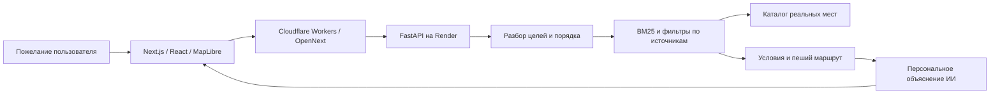

# Astana Compass

Городской ИИ-помощник, который превращает пожелание о прогулке по Астане в маршрут по реальным местам. Можно написать «сначала пицца, потом Ботанический сад»: приложение выделяет отдельные цели, находит подходящие организации и соединяет остановки на карте.

**[Открыть приложение](https://astana-compass.sultankulovce.workers.dev/walk)** · **[Сценарии демонстрации](docs/DEMO.md)** · **[Техническое описание](docs/README.md)** · **[Разработка и запуск](docs/DEVELOPMENT.md)** · **[Архитектура](ARCHITECTURE.md)**

Актуальный исходный код для оценки: **[ветка coordinator/map-interaction](https://github.com/chinusoid/astana-compass/tree/coordinator/map-interaction)**. В ней находится полный проект; отдельное восстановление исходников из ZIP не требуется.

## Что можно показать

- Пожелание на русском, казахском или английском — основной ввод. Ручные фильтры изначально выключены; обязательные условия задаются отдельно.
- Последовательность до шести запрошенных остановок: еда, парки, торговые центры, культура и конкретные названия мест. Промежуточное «зайти по пути» учитывается перед конечной целью.
- Общий маршрут с цветными участками, стрелками и номерами. Можно увидеть весь путь, открыть место, удалить остановку или изменить порядок.
- Время служит ориентиром: подходящий длинный маршрут остаётся доступен с указанием превышения.
- Персональные ИИ-пояснения связывают каждую выбранную остановку с пожеланием. Советы отделены от исходных фактов об организациях.
- Дополнительные идеи предлагают отдельно: они попадают в маршрут только после добавления пользователем.
- Карточки с фотографиями и атрибуцией, описаниями, адресами, контактами, расписанием и происхождением известных сведений. Отдельный запрос к 2GIS позволяет посмотреть сведения о найденной организации.
- Совместная прогулка: гостевой профиль, компания до пяти человек, общий поиск, чат и добровольный обмен местоположением.
- Карта в 2D/3D, мобильная шторка, голосовой ввод в поддерживаемом браузере и возврат камеры к местоположению. Движущиеся машины и прохожие — демонстрация, реальные пробки включаются отдельно.

## Как устроено решение



Модель разбирает сценарий, но не создаёт организации и координаты. Поиск выбирает записи из каталога; обязательные условия, источники, порядок остановок и расчёт маршрута проверяются программно. Заключительный запрос к модели пишет объяснения для уже выбранных мест. Ошибка необязательной генерации не удаляет найденный маршрут.

**Frontend:** Next.js 16, React 19, TypeScript, MapLibre GL JS, Tailwind CSS, OpenNext. **Backend:** Python, FastAPI, HTTPX, отдельные пакеты данных, поиска, контекста, рекомендаций и провайдеров ИИ. **Интерфейсы:** JSON Schema, сгенерированные TypeScript-типы, Ajv и серверная валидация. **Инфраструктура:** Cloudflare Workers, Render, Docker, uv, pnpm и GitHub Actions. Точные версии, выбор технологий и ссылки на реализацию — в [техническом README](docs/README.md).

## Данные и достоверность

В репозитории находится воспроизводимый снимок **682 реальных POI OpenStreetMap**, включая 54 объекта с исходным тегом торгового центра. Для 11 мест добавлены 80 утверждений из 16 официальных страниц; используются также точные связи с Wikidata. Это ограниченная выборка, а не полный каталог города.

Факт хранит состояние `known`, `unknown` или `conflicting` и ссылки на подтверждения. Отсутствие сведений о туалете, Wi-Fi, доступности или расписании не превращается в подтверждение. Подсказка ИИ, оценка времени посещения и реальный факт показываются раздельно. Свободный текст модели может ошибаться: проверка ссылок снижает риск выдумок, но не доказывает каждую фразу.

[Происхождение и покрытие данных](docs/data/README.md) · [Лицензии OSM/Wikidata](data/samples/README.md) · [Фотографии и атрибуция](docs/operations/place-photos.md) · [Интеграция 2GIS](docs/operations/twogis.md)

## Быстрый старт

Для готового приложения используйте [публичный сайт](https://astana-compass.sultankulovce.workers.dev/walk). Собственные ключи для его просмотра не нужны.

Для локальной разработки установите Python 3.12–3.14, uv, Node.js и pnpm. Зафиксированные версии инструментов и варианты запуска описаны в [DEVELOPMENT.md](docs/DEVELOPMENT.md).

Windows / PowerShell 7, из корня репозитория:

```powershell
pwsh -NoProfile -File .\scripts\dev.ps1 -Mode fixture -LlmProvider none
```

Режим `fixture` запускает три **синтетических** объекта без ключей. Для включённого в Git реального каталога:

```powershell
$env:ASTANA_POI_PATH = (Resolve-Path '.\data\samples\astana-osm.json').Path
pwsh -NoProfile -File .\scripts\dev.ps1 -Mode live -LlmProvider none
```

Интерфейс: `http://127.0.0.1:3000`, API: `http://127.0.0.1:8000`, Swagger: `http://127.0.0.1:8000/docs`. Без ключа модели доступен разбор по правилам; маршрутизация и дополнительные внешние сведения зависят от выбранных провайдеров. Производственная конфигурация отличается от локальных настроек по умолчанию.

## Где оценивать код

| Область | Исходники и описание |
|---|---|
| Архитектура и решения | [ARCHITECTURE.md](ARCHITECTURE.md), [технический README](docs/README.md) |
| Интерфейс и карта | [apps/web](apps/web/README.md) |
| HTTP API и композиция | [services/api](services/api), [docs/api](docs/api/README.md) |
| Контракты | [JSON Schema](contracts.schema.json), [CONTRACTS.md](CONTRACTS.md), [клиент API](packages/api_client) |
| Импорт и поиск | [city_data](packages/city_data/README.md), [retrieval](packages/retrieval/README.md) |
| Контекст и маршруты | [city_context](packages/city_context/README.md) |
| Подбор и объяснения | [recommender](packages/recommender), [ai_providers](packages/ai_providers/README.md) |
| Проверки | [CI](.github/workflows/ci.yaml), [интеграционные тесты](tests/integration), [браузерные сценарии](tests/e2e) |
| Развёртывание | [Cloudflare](docs/operations/deploy-cloudflare.md), [Render](docs/operations/deploy-render.md), [Docker](infra) |

## Безопасность и ограничения

Ключи OpenAI/NVIDIA, TomTom и 2GIS задаются только в окружении сервера. В Git находятся исходники, lockfiles и примеры настроек с пустыми значениями. Ключи не нужны для fixture-проверок и не передаются в клиентский bundle. Пользовательский текст и внешние описания считаются данными, а не командами; точные координаты и сырые пожелания не включаются в обычные диагностические логи.

Текущий поиск использует BM25 и словарь RU/KK/EN: embeddings, обученная собственная модель и рабочее хранилище PostgreSQL/pgvector не заявляются реализованными. У внешних сервисов есть квоты, ограничения покрытия и возможные сбои. Приблизительный путь явно отличается от подтверждённой пешей геометрии. Бесплатный сервер может запускаться дольше после простоя.

Гостевой профиль действует до семи дней с момента создания, комнаты — до 24 часов, отправленная позиция — до 15 минут. Сейчас социальные данные находятся в памяти процесса и теряются при перезапуске. Проверки WebKit не заменяют испытания на физическом iPhone. Подробнее — [архитектура и границы решения](ARCHITECTURE.md).
