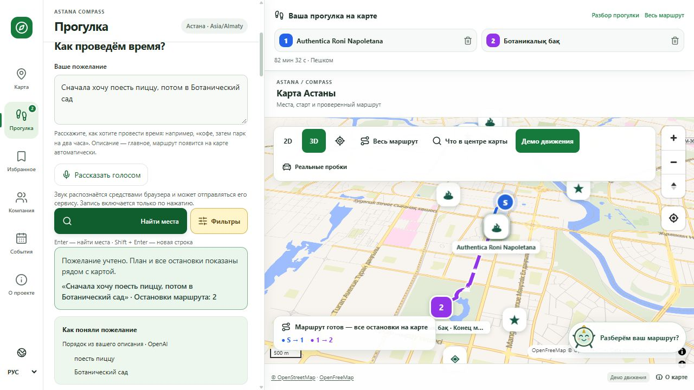

# Демонстрация Astana Compass

[Открыть сайт](https://astana-compass.sultankulovce.workers.dev/walk) · [Описание проекта](../README.md) · [Технологии](README.md) · [Архитектура](../ARCHITECTURE.md)

Ниже — точные формулировки, проверенные на публичной версии 20 октября 2026 года. Это результаты конкретного прогона, а не обещание стопроцентной доступности внешних сервисов или одинакового ответа модели при каждом повторении.

## Одинаковая подготовка для всех запросов

1. Откройте **«Прогулка»**, язык **РУС**.
2. В разделе «Откуда начнём?» раскройте **«Ввести координаты вручную»**. Широта: **51.1283**, долгота: **71.4305** — публичная точка у Байтерека. Нажмите **«Использовать эту точку»**. Это воспроизводимый старт, а не запрос личной геолокации.
3. Оставьте **«Без фильтров»**, без возвращения к началу. Для сравнения с прогоном можно поставить ориентир 100 минут; превышение времени не должно удалять запрошенные места.
4. Вставьте один запрос целиком и нажмите **«Найти места»**. Дождитесь завершения поиска и автоматического расчёта общего пути. Не запускайте поиск многократно подряд.
5. Если карта слишком приближена, нажмите **«Весь маршрут»**. На телефоне после поиска карта открывается автоматически; шторку с карточками можно поднять обратно.

После простоя бесплатный API может просыпаться дольше обычного. Перед записью заранее откройте сайт. Расписания и ограничения источников показывайте честно: наличие маршрута не означает, что все заведения сейчас открыты.

## 1. Пицца, затем Ботанический сад

```text
Сначала хочу поесть пиццу, потом в Ботанический сад
```

**Проверено через интерфейс сайта:** две остановки в нужном порядке, автоматическое отображение общего пути и персональные объяснения. В прогоне получились **Authentica Roni Napoletana → Ботаникалық бақ**, полный итог **82 мин 32 с** без возвращения. Это замер данного выбора, а не фиксированная длительность прогулки.

Покажите: текст пожелания, блок «Как поняли пожелание», два пункта над картой, цветные участки пути и «Почему подходит» в карточке сада. Можно открыть любую точку: маршрут должен остаться на карте. Дополнительные идеи находятся отдельно и не считаются запрошенными остановками.



## 2. Торговый центр по пути к конечной цели

```text
Хочу в Ботанический сад, а по пути зайти в MEGA Silk Way.
```

**Проверено через публичный API и общий маршрут:** **Mega Silk Way → Ботаникалық бақ**. Конечная цель написана первой, но «по пути» переносит торговый центр перед садом. Подтверждённый пеший путь вернул FOSSGIS OSRM, геометрия содержала 326 точек; полный ориентир — **137 минут**.

Покажите правильный порядок и превышение 100 минут: приложение сохраняет обе остановки и сообщает полный расчёт. Кафе со словом Mega не должно подменять торговый центр.

## 3. Четыре разных занятия в одной прогулке

```text
Сначала хочу почитать книги в библиотеке, затем поесть суши, после этого посмотреть кино, а закончить прогулку у Астана Оперы.
```

**Проверено через публичный API и общий маршрут:** Национальная академическая библиотека → **Астана Кузин** → **Арман 3D** → **Астана Опера**. Все четыре цели сохранились. FOSSGIS OSRM вернул связную пешую геометрию из 417 точек; полный ориентир — **195 минут**.

Покажите разнообразие типов мест и их порядок. Время на еду и культурную остановку — оценка, не длительность конкретного фильма или спектакля. Афиша, билеты и доступность нуждаются в отдельной проверке.

## Короткая последовательность для видео

| Момент | Действие и смысл |
|---|---|
| Начало | «Опишу, как хочу провести время. Сервис сам найдёт реальные остановки». Показать первый запрос и заданный старт. |
| Результат | Показать обе остановки и весь путь. «Пицца и сад — разные цели; они соединены в нужном порядке». |
| Объяснение | Открыть карточку сада, прочитать персональную причину выбора и показать отдельный блок сведений из источника. |
| Дополнительная идея | Показать «Идеи по пути»: это предложения, которые пользователь добавляет сам. Для основного дубля добавлять их не обязательно. |
| Сложный сценарий | Вторым дублем показать «MEGA по пути» либо четыре разных занятия. Подчеркнуть порядок и сохранение длинного маршрута. |
| Код и решения | Показать GitHub README, архитектурную схему и технический путеводитель: модель → реальные записи → проверка условий → маршрутизация → объяснение. |

## Что именно подтверждено

- Публичный frontend: `08cc83e718a693ebb64a4a785418b4cf333cc643`; API: `d46df2427ef65fe637b699c3bfde6adc50deedb7`.
- Для сценариев 2 и 3 получены HTTP 200, реальные записи, все ожидаемые цели, персональная проза и полный маршрут `routed` в исходном порядке. Ответы имеют статус `partial`: сервис сохраняет предупреждения о неподтверждённых сведениях и оценках времени. Это не HTTP-ошибка и не означает отсутствие маршрута.
- Для сценария 1 выполнен поиск через опубликованный интерфейс, увидены две остановки, линия общего пути, длительность и персональные объяснения. Скриншот выше относится к этому прогону.
- Один другой вариант текста — «Хочу сначала поесть пиццу, а потом прогуляться в Ботаническом саду.» — в этой проверке нашёл только пиццерию. Для записи используйте точную проверенную формулировку первого сценария; произвольные перефразирования не объявляются проверенными.
- Новая внешняя квота, изменившийся ответ модели, сеть, разрешения браузера или недоступность сервиса могут изменить результат. Проверка не подтверждает физическую доступность места, текущую работу заведения или испытание на реальном iPhone.
