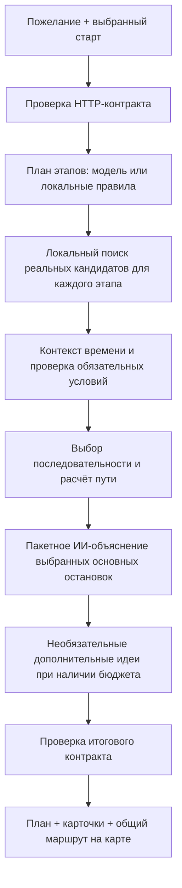

# Технический путеводитель Astana Compass

Astana Compass подбирает прогулку по свободному пожеланию и выбранной точке старта: например, «сначала пицца, затем ботанический сад, а после немного искусства». Результат — последовательность реальных мест, объяснения выбора, отдельные дополнительные предложения и связанный маршрут на карте. Есть одиночное планирование и общий план компании до пяти участников.

Этот документ описывает **реализацию в репозитории**, а не обещания будущего продукта. Для запуска используйте [руководство разработчика](DEVELOPMENT.md), для общей схемы — [архитектуру](../ARCHITECTURE.md), для форматов обмена — [контракты](../CONTRACTS.md).

## Что можно оценить

| Сценарий | Как устроен сейчас | Граница результата |
|---|---|---|
| Пожелание своими словами | ИИ разбирает последовательность занятий; локальные правила сохраняют базовый сценарий при сбое модели | Произвольная формулировка не гарантирует, что в ограниченном каталоге найдётся нужное место |
| Несколько целей | До шести остановок, именованные места, типы занятий, кухня и порядок посещения | Не найденная цель отмечается; другой парк не должен скрыто заменять пиццерию |
| Время прогулки | Ориентир из пожелания или настроек; показывается полный расчёт и превышение | Длительность посещения оценивается, а не подтверждается источником |
| Удобства и ограничения | Отдельно учитываются обязательные условия и предпочтения | Неизвестное удобство не считается выполненным обязательным условием |
| Карта | 2D/3D, здания, цветные участки пути, стрелки, номера остановок, обзор всего маршрута | Географическая подложка и каталог рекомендаций — разные источники |
| Объяснение выбора | Один дополнительный запрос к модели пишет текст под пожелание и выбранные основные остановки | Это ИИ-рекомендация; она не становится новым подтверждённым фактом места |
| Дополнительные идеи | После выполнения основных целей локальный подбор предлагает необязательные места | Они подписаны как предложения и не добавляются в основной путь без выбора |
| Компания | Пожелание и старт задаются прямо в разделе; общий подбор учитывает условия участников | Профили, компании, сообщения и события пока находятся в памяти одного API-процесса |
| Телефон | Карта со шторкой, автоматическое раскрытие маршрута, учёт видимой области при клавиатуре | Наличие WebKit-проверок не заменяет проверку физического iPhone |

## Фактический стек

Версии ниже взяты из [frontend manifest](../apps/web/package.json), [его lockfile](../apps/web/pnpm-lock.yaml), [Python lockfile](../uv.lock), [CI](../.github/workflows/ci.yaml) и Dockerfile. Это зафиксированные версии проекта, а не утверждение о последних версиях библиотек.

| Слой | Технологии и версии | Роль |
|---|---|---|
| Среда web | Node.js 24.19.0 в CI, pnpm 11.25.0; manifest допускает Node ≥22.12 | Установка и сборка интерфейса |
| Интерфейс | Next.js 16.4.2, React / React DOM 19.3.1, TypeScript 5.9.3 | Страницы, общее состояние планирования, серверный прокси API |
| Оформление | Tailwind CSS 4.3.3, CSS Modules, lucide-react 1.59.0 | Адаптивная шторка, карточки, элементы карты |
| Карта | MapLibre GL JS 6.15.0, OpenFreeMap; опциональная OSM raster-подложка | Векторная карта, экструзия зданий, линии и декоративные модели |
| Cloudflare | OpenNext 1.20.12, Wrangler 4.151.1 | Выполнение Next.js в Workers и раздача статических файлов |
| Python | 3.12–3.14; uv 0.13.1; контейнер на Python 3.12 | Workspace из семи локальных пакетов |
| API | FastAPI 0.146.0, Uvicorn 0.54.0, Pydantic 2.14.1 | HTTP-граница, композиция модулей, жизненный цикл ресурсов |
| Валидация / сеть | jsonschema 4.26.0, HTTPX 0.28.1; AJV 8.20.0 в web | Проверка общего контракта и ограниченные обращения к провайдерам |
| Поиск | Собственный локальный BM25 и словарь RU / KK / EN | Поиск по snapshot; без embedding-сервиса и векторной БД |
| ИИ | Адаптеры OpenAI Responses API и NVIDIA inference API | Разбор пожелания, план этапов, персональные объяснения; модель задаётся серверной настройкой |
| Проверки | pytest 9.1.1, Ruff 0.17.1; Vitest 5.0.5, Playwright 1.64.1 | Контракты, модули, браузерные сценарии, сборки |

Для общей TypeScript-границы есть отдельный компилятор 7.0.2 в [`.github/typescript`](../.github/typescript/package.json). Он изолирован от TypeScript 5.9.3 интерфейса и не меняет frontend lockfile.

## Где находится код

| Каталог / точка входа | Что читать |
|---|---|
| [`apps/web/src/components/compass-app.tsx`](../apps/web/src/components/compass-app.tsx) | Главный пользовательский поток: пожелание, старт, поиск, выбор и отображение маршрута |
| [`apps/web/src/components/city-map.tsx`](../apps/web/src/components/city-map.tsx) | Карта, выбор точки, геолокация, слои и управление камерой |
| [`apps/web/src/components/mobile-sheet.tsx`](../apps/web/src/components/mobile-sheet.tsx) | Мобильная шторка; вспомогательная логика жестов — `src/lib/sheet-gesture.ts` |
| [`apps/web/src/components/place-card.tsx`](../apps/web/src/components/place-card.tsx) | Карточка рекомендации, факты, источники, идея посещения |
| [`apps/web/src/components/party-panel.tsx`](../apps/web/src/components/party-panel.tsx) | Общая прогулка, пожелание компании, чат и приглашения |
| [`services/api/src/astana_api/app.py`](../services/api/src/astana_api/app.py) | HTTP endpoints и проверка входа/выхода |
| [`services/api/src/astana_api/composition.py`](../services/api/src/astana_api/composition.py) | Создание repository, retriever, context, planner и generator |
| [`packages/recommender/src/astana_recommender/service.py`](../packages/recommender/src/astana_recommender/service.py) | Последовательность подбора, финальная политика ограничений, маршруты и объяснения |
| [`packages/ai_providers/src/astana_ai_providers/journeys.py`](../packages/ai_providers/src/astana_ai_providers/journeys.py) | Разбор сценария на этапы и локальный резервный разбор |
| [`packages/ai_providers/src/astana_ai_providers/narratives.py`](../packages/ai_providers/src/astana_ai_providers/narratives.py) | Один пакетный запрос персональных объяснений для выбранных остановок |
| [`packages/retrieval/src/astana_retrieval/retriever.py`](../packages/retrieval/src/astana_retrieval/retriever.py) | BM25, буквальные имена, категории, кухня, предпочтения |
| [`packages/city_data/src/astana_city_data/importer.py`](../packages/city_data/src/astana_city_data/importer.py) | Отдельная CLI импорта OSM, манифест и воспроизводимый snapshot |
| [`packages/city_context/src/astana_city_context/provider.py`](../packages/city_context/src/astana_city_context/provider.py) | Расписания, маршрутизация и контекст времени запроса |
| [`contracts.schema.json`](../contracts.schema.json) | Канонические DTO; TypeScript-клиент и браузерные валидаторы согласуются с этой схемой |
| [`services/api/src/astana_api/social.py`](../services/api/src/astana_api/social.py) | Гостевые сессии, группы, сообщения, временные координаты и события |

## Как запрос становится прогулкой

### Разбор пожелания

В `live`-режиме planner получает текст и язык. Он выделяет действия, именованные цели, кухню, порядок и смысловые связи: например, промежуточная остановка «по пути» должна оказаться перед конечной целью. Поддержан сценарий до шести этапов. Выход модели проходит структурную проверку и сопоставление с исходным текстом; слово из пожелания не становится автоматически фактом об организации.

Внешняя модель не выбирает произвольные координаты и не придумывает объекты. После разбора реальные кандидаты всё равно извлекаются из каталога. Если inference недоступен, используются ограниченные правила с предупреждением. Сложные пожелания и неоднозначные цели могут потребовать уточнения.

### Поиск кандидатов

Repository загружает неизменяемый JSON snapshot. Поиск получает ограниченный набор ближайших мест — по умолчанию до 1000 — и проверяет радиус по haversine. Это предварительный географический отбор, а не длина пешего пути.

BM25 использует `k1=1.2`, `b=0.75`, исходные названия и подтверждённые aliases, категории, описания и известные факты. Имена имеют больший вес, чем обычный текст описания. Буквально указанное название получает приоритет; подтверждённая кухня обрабатывается отдельно. Так `shop=mall` позволяет найти торговый центр, а похожее имя кафе не превращает его в ТРЦ. Для общих прогулок сопоставимые кандидаты могут чередоваться по темам ради разнообразия.

Это **лексический поиск с расширением словаря**, не семантический vector search. Score не является вероятностью качества или оценкой красоты места. Отрицания и несколько частых опечаток поддержаны ограниченными правилами; все формы языка и произвольные названия ими не покрываются.

### Ограничения и время

`required` — обязательное условие. Оно выполняется только при подтверждённом факте нужного значения; `unknown` и `conflicting` не превращаются в `true`. `preferred` — пожелание: оно влияет на выбор и предупреждения, но не подменяет основной текстовый сценарий. Результаты дополнительно проверяются после получения динамического контекста.

Время прогулки — мягкий ориентир. Маршрут дольше выбранного времени остаётся видимым, с полной длительностью и превышением. При этом явно обязательные условия не отключаются ради получения результата. Время дороги и оценка времени посещения показываются раздельно; работа заведения к моменту прибытия на весь визит не гарантируется проверкой расписания только на время старта.

### Маршрутизация

Пакет `city_context` поддерживает пешие адаптеры OpenRouteService, FOSSGIS OSRM и TomTom. Проверяются упорядоченные waypoints, участки и целостность маршрута. В web один план соединяет все выбранные остановки, участки получают цвета, номера и стрелки; изменение вида карты не должно сбрасывать путь.

При отсутствии полного ответа может вернуться явно подписанная **приблизительная оценка с `geometry=null`**. Она не выдаётся за рассчитанную дорогу по тротуарам. Настройка `ASTANA_ROUTE_ALLOW_APPROXIMATE=false` требует полноценный маршрут вместо такого fallback. Велосипед и автомобиль не заявляются рабочими режимами пользовательского планировщика.

### Персональные объяснения

После выбора основных остановок один запрос к настроенной модели получает пожелание и ограниченные публичные сведения об этих местах. Он пишет живой текст о том, почему остановка подходит именно этому сценарию, и короткую идею занятия. Это отдельный этап от разбора пожелания; ранее используемый выбор ссылок на факты остаётся совместимым резервным механизмом.

В модель не добавляются структурные поля старта, маршрута, координат, профиля или чата. Публичные описания могут содержать адресный текст, а сам пользователь может вписать личные сведения в пожелание. Ответ ограничивается по размеру и проверяется по идентификаторам остановок и их ссылкам на переданные источники. Есть дополнительные проверки некоторых неподтверждённых деталей, например картин у объекта, известного только как `artwork`.

**Проверка ссылок не доказывает смысловую истинность всей свободной прозы.** Объяснение остаётся ИИ-советом, не обновляет `PlaceFact` и не подтверждает неизвестные удобства. При недоступности модели сохраняется пригодный маршрут и появляется предупреждение об обычном объяснении по данным. Дополнительные идеи выбираются отдельно и не должны отнимать время у выполнения основных целей.

## Данные и источники

В репозитории находится snapshot **682 реальных POI** из OSM, включая 54 записи с исходным `shop=mall`. Он дополнен Wikidata и проверенными заметками из официальных страниц: 80 утверждений для 11 мест из 16 страниц. Это ограниченное покрытие; наличие открытой карты не означает наличия всех организаций в каталоге.

Каждый факт имеет ключ, значение, статус (`known`, `unknown`, `conflicting`) и ссылки на evidence. В evidence сохраняются источник, исходная запись и время получения. Импорт выполняется отдельно от пользовательского поиска. Дата скачивания не выдаётся за дату проверки заведения на месте. Снимок, его манифест и исходные кэши позволяют проследить происхождение данных.

| Источник / интеграция | Использование |
|---|---|
| OSM / Overpass | Каталог, исходные теги, названия, базовые сведения; атрибуция ODbL |
| Wikidata | Дополнительные названия и описания, когда они есть в источнике |
| Официальные страницы | Проверенные описания и отдельные подтверждённые характеристики ограниченного числа мест |
| Nominatim / OSM lookup | Сведения о точке карты по явному действию пользователя; это отдельный поиск от рекомендаций |
| 2GIS Places | Отдельная кнопка в полной карточке; сведения кандидата не подменяют факты другого объекта |
| TomTom | Отдельные адаптеры мест, пешей маршрутизации и дорожного потока при серверном ключе |
| Wikimedia Commons | Фотографии с доступной атрибуцией; при отсутствии снимка — подписанная иллюстрация |
| Open-Meteo | Опциональный внутренний контекст; не подтверждает безопасность погоды и выключен по умолчанию |

Движущиеся машинки и прохожие на карте — декоративная симуляция, включённая по умолчанию. Слой реального дорожного потока запрашивается отдельно. Число нарисованных моделей не является измерением количества автомобилей.

## Надёжность и приватность

- Каноническая схема проверяется на границах Python API, модулей и web-клиента. Координаты JSON — `{lat, lon}`, GeoJSON — `[lon, lat]`; время привязано к `Asia/Almaty`.
- Ключи провайдеров читаются только Python-сервисом. В исходниках и `.env.example` находятся имена настроек, без рабочих секретов. Next.js обращается к API через серверный прокси.
- По умолчанию API имеет HTTP deadline 30 секунд, recommender делит до 26 секунд между зависимостями. Hosted planner ограничен своим deadline; пакетное объяснение получает не более 6 секунд и оставшийся общий бюджет. Неверное объяснение не меняет выбранные места.
- Hosted-вызовы делят лимиты процесса: по умолчанию 10 запросов в минуту и 100 в день. Это счётчик обращений, **не денежный лимит**; платёжные ограничения настраиваются у провайдера.
- Сырые пожелания, точные координаты и тексты чатов не нужны обычным диагностическим логам. Для ошибок используются безопасные категории и request ID. Нельзя включать подробное логирование без отдельной политики хранения.
- Публичные провайдеры имеют ограничения частоты, времени и объёма ответа. Их доступность не следует из успешного unit-теста. Автоматическое повторение пользовательского POST не используется для маскировки сбоя.
- Гостевой профиль живёт до семи дней **с создания**, без скользящего продления; компания и чат — до 24 часов. Переданная вручную точка участника истекает через 15 минут. Всё это теряется при перезапуске API.
- Обмен местоположением требует отдельного действия. Фото уменьшается и очищается от метаданных перед отправкой. Голосовой ввод включается пользователем и зависит от возможностей и сервиса распознавания браузера.

## Что проверяет CI

[Workflow](../.github/workflows/ci.yaml) содержит Python matrix 3.12/3.14, отдельную проверку TypeScript-клиента, web typecheck/lint/unit/build, Playwright Chromium/WebKit, два контейнерных профиля и сборку Cloudflare Worker с проверкой в workerd. Артефакт Worker содержит исходный revision для сопоставления публикации с кодом.

Локальные fixtures и подменённые провайдеры проверяют поведение программы без секретов и платных запросов. Отдельные браузерные сценарии используют локально загруженный реальный каталог. Это не проверка текущего качества hosted-модели, живых пробок, каждого расписания или реального устройства iOS. Наличие workflow и команд не означает успешное выполнение на любом текущем commit: фактический статус смотрят в соответствующем запуске GitHub Actions.

## Текущая публикация и следующий шаг

Вариант размещения состоит из Cloudflare Workers для Next.js и Render для Python API. Он использует тот же код, но секреты и runtime-настройки задаются владельцем хостинга. Публичный репозиторий запускается без этих ключей в `fixture` или с реальным snapshot и локальными правилами. Установка зависимостей не создаёт аккаунты и не включает платные тарифы.

Для постоянного сервиса нужны долговременное хранилище профилей/компаний, общие квоты и состояние между экземплярами API, расширение источников, отдельная оценка на реальных пользовательских сценариях и наблюдаемость без утечки запросов. В Compose уже есть **необязательный** профиль PostgreSQL/pgvector, однако действующие repository и retriever к нему не подключены. Embeddings, векторный поиск, обучение собственной модели и постоянные аккаунты — возможное развитие, а не существующие функции.
