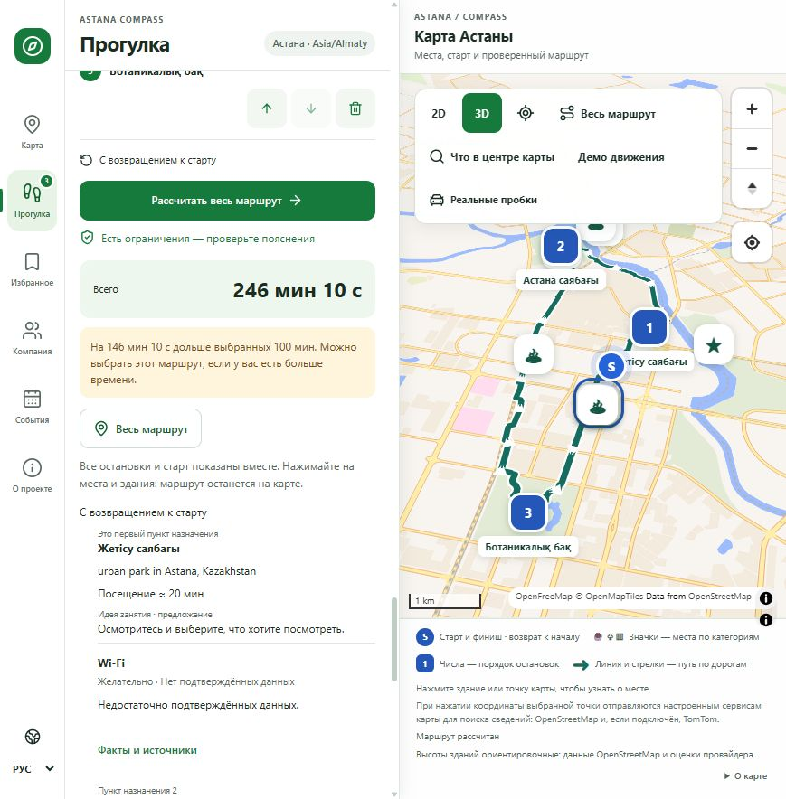
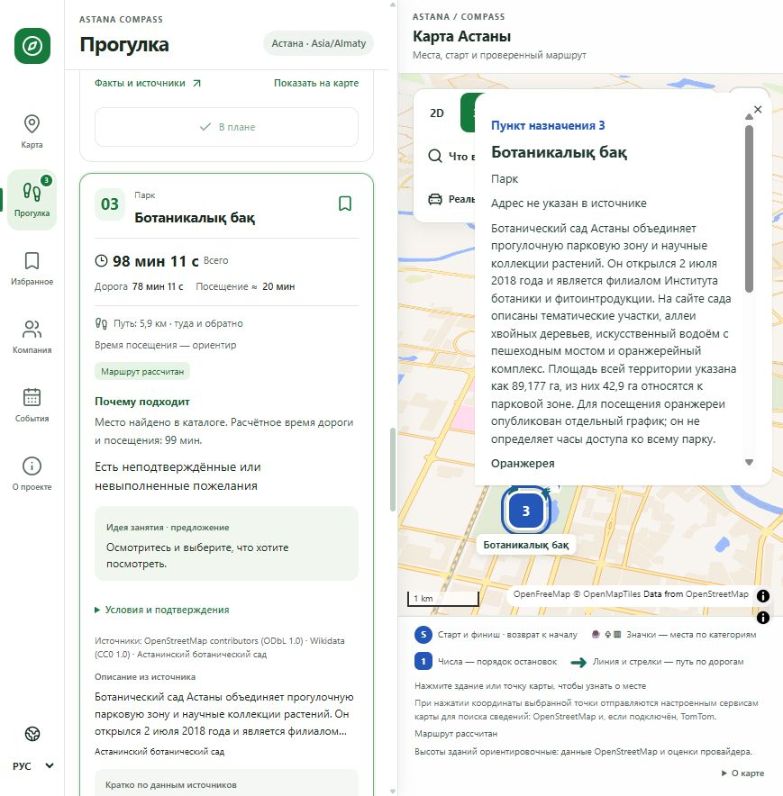
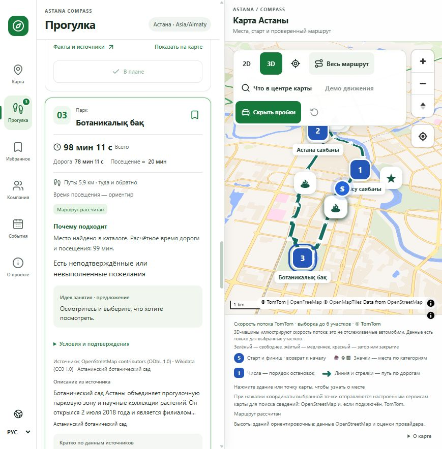

# Проверка опубликованной версии — 19 октября 2026

## Обновление: прогулки с тремя остановками

Публичный frontend `366f91e` опубликован как Cloudflare version
`f0e2f3e0-294d-4256-b63b-aa73c32d1b09`. Основной сценарий впервые проверен
на frontend `a221368` и повторён после исправления popup на `366f91e`.
Использовались настоящие ответы API; личная геолокация не запрашивалась.

- Ручной старт у Байтерека: `51.1283, 71.4305`. Пресет «Парки» заполнил запрос
  «Прогулка по паркам». Время — 100 минут, возврат включён, Wi-Fi — пожелание.
- Enter показал состояние поиска, затем подтверждение применения и три парка:
  Жетісу саябағы, Астана саябағы (Центральный парк), Ботаникалық бақ.
  Отсутствие подтверждённого Wi-Fi не исключило подходящие места.
- «Собрать один маршрут · мест: 3» построила общий путь с возвращением:
  246 мин 10 с, из них 186 мин 10 с дорога и 60 минут ориентировочных посещений.
  Превышение выбранных 100 минут показано явно: 146 мин 10 с.
- «Весь маршрут» показала остановки 1, 2, 3 и старт/финиш одновременно.
  Нажатие на третью остановку открыло описание Ботанического сада и отдельные
  часы оранжереи. Открытие постороннего Starbucks сохранило общий маршрут.
- Карточки Центрального парка и Ботанического сада показали описания,
  подтверждённые сведения и ссылки на Visit Astana / сайт сада. Неизвестные
  свойства собраны в сворачиваемый блок; неизвестный Wi-Fi не выдан за имеющийся.
- Кнопка возврата камеры к местоположению присутствует. Работа с настоящей
  геолокацией в этом публичном прогоне не проверялась; разрешение не выдавалось.
- Отдельный запрос к опубликованному `/v1/intent` вернул `provider=openai`:
  «Хочу спокойную прогулку, у меня 100 минут» → 6000 секунд и `quiet=preferred`.
  Сохранённая модель Render — `gpt-6-luna`.

Первый API-прогон общего пути вернул 635 точек геометрии и 13,95 км от
FOSSGIS OSRM. В тот момент TomTom переключился на резервный источник;
этот результат сам по себе не подтверждает успешный ответ TomTom.

### Читаемая карточка в узком окне

На `366f91e` popup Ботанического сада целиком помещается внутри карты в окне
870 × 884: левая граница 527 px, правая 857 px, ширина 330 px. Заголовок,
описание, прокрутка и закрытие доступны. Проверен клик по третьей остановке;
общий маршрут сохраняется. Исправление покрыто 28 целевыми frontend-тестами.

### Дорожная обстановка TomTom

На API `4598925` контрольный `/v1/traffic` возле Байтерека вернул HTTP 200,
`status=live`, `provider=TomTom` и один дорожный сегмент. Затем кнопка
«Реальные пробки» проверена в опубликованном UI: показаны слой, атрибуция
TomTom и пояснение о выборке до шести участков. Общий маршрут сохранился.
3D-машины иллюстрируют скорость потока, а не отслеживают настоящие автомобили.
Это точечная проверка, не доказательство покрытия всех улиц города.

### TomTom Nearby Search и пешие маршруты

API `f4d0181`, Render deploy `dep-dbb44du7bikc73d0bp90`, проверен отдельно:

- Клик возле Байтерека: HTTP 200, восемь результатов суммарно из
  OpenStreetMap / Nominatim и TomTom Maps Nearby Search. Записи сохраняют
  отдельную атрибуцию; ближайший бизнес не объявляется выбранным зданием.
- Master coffee (`osm:node/12208842419`, публичная координата из каталога) →
  Центральный парк (`osm:relation/15957444`): HTTP 200 за 0,922 с,
  `provider=TomTom Maps`, `method=routed`, 1317 м, 948 с пешком,
  2148 с вместе с ориентировочным посещением. Путь содержит 18 точек
  геометрии, одну остановку, без возвращения. Сохранена только сводка QA.
- План трёх парков от центра Байтерека продолжил использовать OSRM:
  ближайшая точка сети TomTom оказалась в 194 м от старта, за пределами
  допуска 100 м. Ограничение старта сохранено, резервный источник обозначен.

Это проверка отдельных запросов, а не гарантия покрытия всего города.
Автоматическая цепочка всех остановок, порядок «сначала кофе, потом парк»
и демо движения по умолчанию добавлены следующими коммитами; их последующий
публичный прогон фиксируется в описании PR и материалах релиза.

## Предыдущая опубликованная версия

Приложение: https://astana-compass.sultankulovce.workers.dev

Проверены frontend `2667fb9` (Cloudflare version
`2514ca36-851f-4791-91bc-d1f188362ebb`) и API `0090741` на Render.
[Все 7 проверок CI кода прошли](https://github.com/chinusoid/astana-compass/actions/runs/39242909827).
Снимки ниже сделаны с опубликованного сайта в браузере, без подмены ответов API.

## Проверенный сценарий

- Тестовая стартовая точка — Байтерек, а не местоположение пользователя.
- OpenAI распознал пожелание о кофе и 60 минутах. Условие времени применилось после выбора и подтверждения.
- Enter запустил поиск: сначала показан индикатор ожидания, затем статус применения и три варианта.
- Rafe без подходящих подтверждённых удобств получил нейтральное объяснение; технические поля OSM не показаны как причина посещения.
- План CrepeCafe → Degirmen → старт рассчитан по пешим дорогам: 57 мин 31 с вместе с ориентировочными посещениями, из них дорога 17 мин 31 с. На карте видны линия, стрелки, остановки 1/2 и старт/финиш.
- Неактивная остановка открылась с первого клика; первая остановка также открылась по Enter. Карточка сохранилась после обновления выбора.
- Клик по крыше 3D-модели Байтерека выбрал точку внутри основания и показал Байтерек, адрес Ақмешіт көшесі, 14 и сведения OSM.
- Включено демонстрационное движение простых 3D-моделей. Оно не представляет реальные пробки или людей.

Первый поиск в этой проверке вернул приблизительные оценки отдельных маршрутов;
интерфейс явно их обозначил. Последующий расчёт общего плана вернул настоящую
пешую геометрию. Причина первоначального перехода к оценке не установлена.
Доступность публичных OSRM/Nominatim не гарантируется. Недостающие описания и
удобства остаются неизвестными; получение данных не означает проверку на месте.

## Снимки интерфейса

