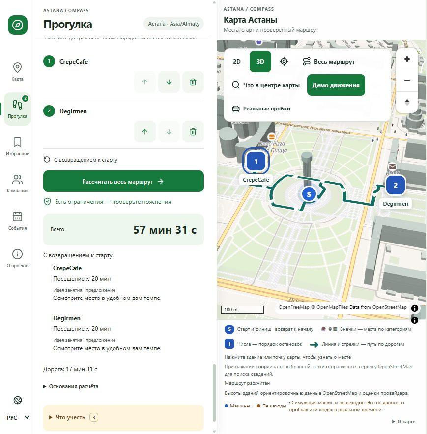
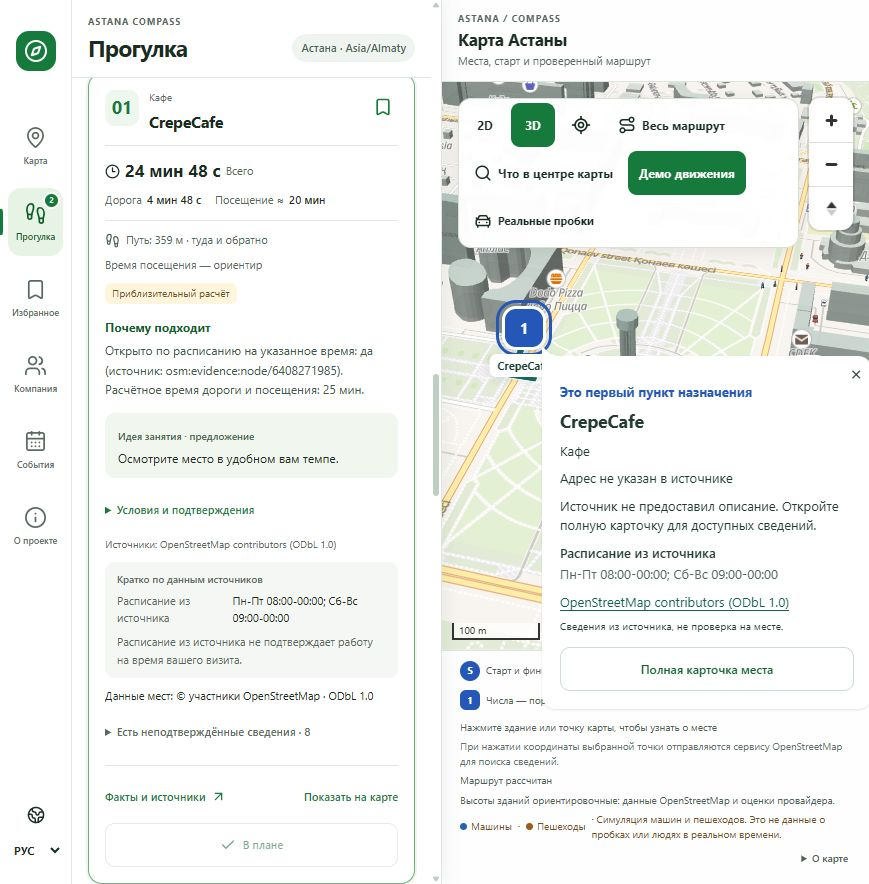
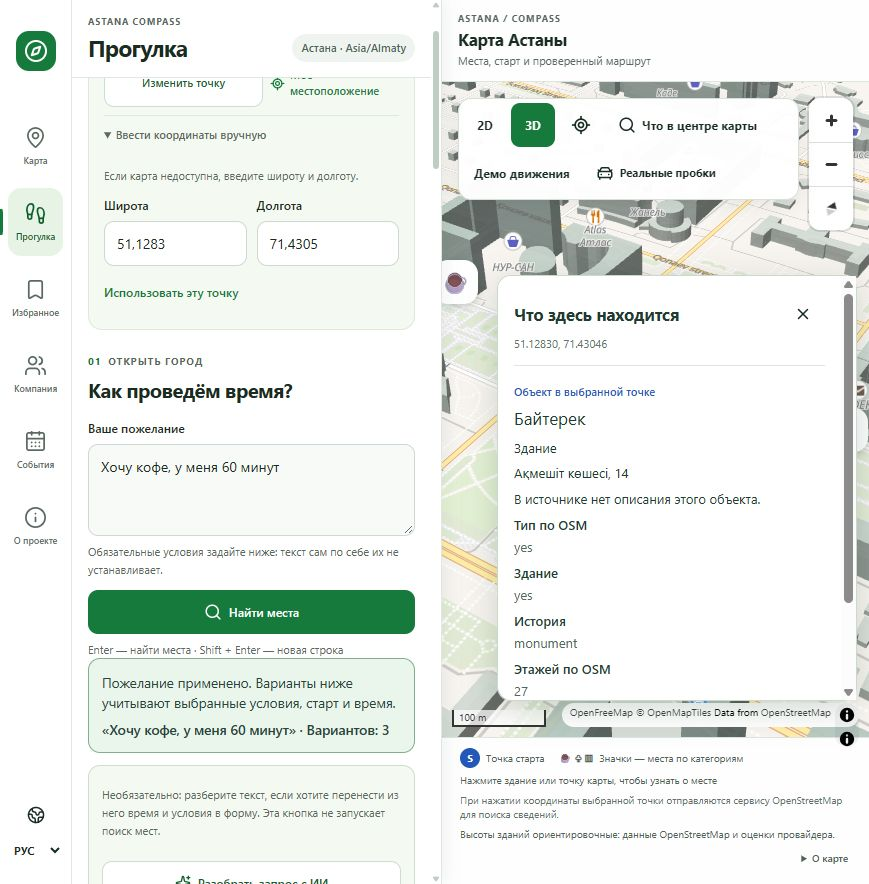

# Проверка опубликованной версии — 19 октября 2026

Приложение: https://astana-compass.sultankulovce.workers.dev

Проверены frontend `2667fb9` (Cloudflare version
`2514ca36-851f-4791-91bc-d1f188362ebb`) и API `0090741` на Render.
[Все 7 проверок CI кода прошли](https://github.com/chinusoid/astana-compass/actions/runs/39242909827).
Снимки ниже сделаны с опубликованного сайта в браузере, без подмены ответов API.

## Проверенный сценарий

- Тестовая стартовая точка — Байтерек, а не местоположение пользователя.
- OpenAI распознал пожелание о кофе и 60 минутах. Условие времени применилось после выбора и подтверждения.
- Enter запустил поиск: сначала показан индикатор ожидания, затем статус применения и три варианта.
- Rafe без подходящих подтверждённых удобств получил нейтральное объяснение; технические поля OSM не показаны как причина посещения.
- План CrepeCafe → Degirmen → старт рассчитан по пешим дорогам: 57 мин 31 с вместе с ориентировочными посещениями, из них дорога 17 мин 31 с. На карте видны линия, стрелки, остановки 1/2 и старт/финиш.
- Неактивная остановка открылась с первого клика; первая остановка также открылась по Enter. Карточка сохранилась после обновления выбора.
- Клик по крыше 3D-модели Байтерека выбрал точку внутри основания и показал Байтерек, адрес Ақмешіт көшесі, 14 и сведения OSM.
- Включено демонстрационное движение простых 3D-моделей. Оно не представляет реальные пробки или людей.

Первый поиск в этой проверке вернул приблизительные оценки отдельных маршрутов;
интерфейс явно их обозначил. Последующий расчёт общего плана вернул настоящую
пешую геометрию. Причина первоначального перехода к оценке не установлена.
Доступность публичных OSRM/Nominatim не гарантируется. Недостающие описания и
удобства остаются неизвестными; получение данных не означает проверку на месте.

## Снимки интерфейса

